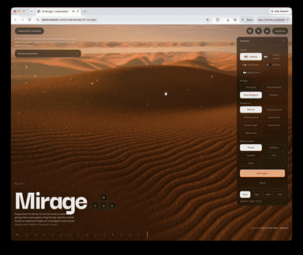

# Day 15: Mirage

[Try it live](https://adamwebsite.com/codevember/15-mirage/)

A little desert whose sand turns to water under your hand. Where the water lingers, grass and palms grow, until the desert is an oasis.

## How to play

Drag across the dunes to turn the sand to water. Keep going and an oasis grows. Drag the sky, hold the middle button or swipe two fingers on a trackpad to look round.

Run it locally with `npm run dev` from the repo root, then open <http://localhost:3000/15-mirage/>.

## Technical overview

### Sand and water

- The patch is a heightfield grid simulated on the GPU in WebGPU compute: each column holds its sand, its water, the water's flow to its neighbours and how wet it is. Under the hand, sand turns to water, which runs downhill by the shallow-water pipe method and pushes the way the hand moves; dry sand slumps back toward the dunes, and shallow edges dry out again while the deep water stays.
- Hundreds of thousands of grains are drawn as tiny lit beads, each with its own shade, the odd dark grain or bright fleck of quartz glinting off a facet of its own. Only the grains in view and big enough to see are drawn: a compute pass lists them each frame with an atomic counter and the draw reads from that list, so far grains thin out and close ones fade into the sand's own fine grain rather than looming as pebbles.
- The water is lit for every pixel: ripples, a reflection traced through the scene, the sand bed seen through it darkening with depth, caustics on the bed and froth at its edges. Wind ripples are laid across the dry sand, and the shadows of the dunes are found by stepping toward the sun over the grid.

### The oasis

- Moisture spreads out from the water, and where it lingers the desert greens: up to 900,000 blades of grass in clumps of eight kinds, from fine turf to reeds standing in the water with plumes, feather grass, sedge and wild oats nodding with seed. Each clump is worked out once a frame in a compute pass, passed over until it can grow, and drawn only if it is grown and in view.
- Seven kinds of palm, from tall date and coconut palms to sago and fan-palm bushes, sprout as green stems, turn woody and leaf out. Their trunks are crooked and knotted with the stubs of cut fronds, their fronds are built leaflet by leaflet with tears and twists, and each tree takes its own shade of green. A palm never shrinks once grown: dig away the ground beneath it and the trunk reaches down to the new ground. The palms shade the sand, the grass and the water, and far palms are drawn with less detail.

### Animals

- Once there is water, flamingos fly in, flare and land, stroll for a while, then wade in to feed, rest and preen; camels arrive alone, in pairs or as a family with a calf, pacing to the water to drink; birds wheel high over the desert from the start.
- The flamingos and camels are each one smooth skin, built once: a skeleton of tapered rods blended together and meshed by surface nets, with occlusion baked in, then bent every frame by its bones on the GPU, with fur or feathers drawn in the shader. The camels pace, both legs on a side together, at the speed their strides carry them so their feet never slide.

### Sky, light and the mirage

- Clouds drift across the sky and their shadows cross the sand; light shafts are marched through the air against the scene's depth, and dust motes catch the sun. The mirage itself is a wall round the patch, bent by a ray march: a shimmering lake with heat streaks, heat haze, ribbons, or the default Fata Morgana, the far dunes stretched up into towers.
- The camera flies as in Labyrinth, and two fingers on a trackpad turn the view. Depth of field focuses like an eye, reading how far off whatever is in the middle of the frame stands from the scene's own depth, so palms, camels and grass come sharp; its blur eases with distance, as through a lens.
- Sound: seven ambiences to choose from and five voices for sand turning to water, a pop as each palm breaks the ground, footfalls and calls, all synthesised in Web Audio, over a music track.

Everyone whose work Codevember builds on is listed in [CREDITS.md](../CREDITS.md).
