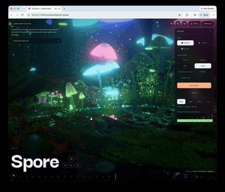

# Day 16: Spore

[Try it live](https://adamwebsite.com/codevember/16-spore/)

A forest floor at night. Spores drift down where you touch it, and where they land a bioluminescent bloom grows and spreads.

## How to play

Tap the forest floor to let spores go. Where they land, glowing mushrooms grow, and threads of light spread between them under the leaves. Hold, then drag, to scatter a trail. Drag to look round.

Run it locally with `npm run dev` from the repo root, then open <http://localhost:3000/16-spore/>.

## Technical overview

### Mushrooms

- Each mushroom is one instanced draw whose shape a TSL shader builds from a vertex tag: stem, cap or gill.
- Growth, glow waves and spore bursts run on the GPU from the clock; spores that land seed new clusters.

### Mycelium and light

- Mycelium threads fork out from each cluster as camera-facing strips, with light pulses running along them.
- A coarse floor grid, filled on the CPU with mushroom and thread light, tints nearby litter, logs and ferns.

### The forest floor

- A Poly Haven leaf-litter scan, displaced, with puddles reflecting through a second camera.
- Thousands of instanced leaves, twigs, stones and ferns, split into wedges so whatever is behind the eye is culled.

### The night

- Deer walk a four-beat gait as silhouettes in the mist, under a Milky Way sky with fireflies.
- Crickets, owl, chimes and spore sounds are synthesised in Web Audio over music.

Everyone whose work Codevember builds on is listed in [CREDITS.md](../CREDITS.md).
