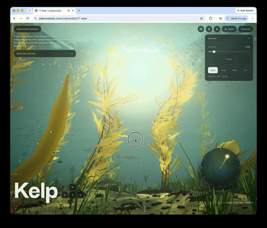

# Day 17: Kelp

[Try it live](https://adamwebsite.com/codevember/17-kelp/)

A kelp forest under a moving surface: giant kelp to the top, sugar kelp on the rocks, sargassum adrift overhead, and fish from sardines to sharks. Sweep through it and the water moves.

## How to play

Sweep the pointer through the kelp to stir the water. Tap to send a surge. Press and hold on a kelp to pull it about, and turn the dial to move the sun.

Run it locally with `npm run dev` from the repo root, then open <http://localhost:3000/17-kelp/>.

## Technical overview

### The kelp

- A few big plants, four close in front of where the eye starts and three out in the haze, rather than a crowd of them: the giants are the costly part to simulate, and low kelp carries the rest of the floor. The near four are drawn finer, with longer, more finely divided blades and veins that show close up, and the far three coarsely.
- Giant kelp as it grows: a holdfast gripping the floor, a low cone of dozens of root-like haptera climbing the stipes' bases, each tapering as it arches out into the sand and forking twice on the way, with grass coming up round it, several stipes rising from it, some to the top and some stopping short, with side branches off them partway up, a ruffled, corrugated blade on a gas-filled float at every node, and the stipes that reach the top lying along the surface as a canopy.
- Each stipe is a chain of points moved on the processor: carried by the water round it, dragged toward its speed, lifted by its floats and held to its length by following the chain up from the root, so it never stretches. Stipes are drawn as smooth tubes through those points, and each blade is bent on the GPU to stream the way the water passes it, fluttering and twisting. Each blade's side is squared to its own fixed level direction, with a little of the way across the stipe added, so it turns smoothly however the stipe lies and never flips.
- A side branch is a chain of its own whose root rides on a point of the stem it grows from, so it goes wherever that point goes.

### The water

- The swell passing overhead swings every bit of water to and fro, less the deeper it is, so the forest leans one way and then the other as each wave goes by. Under it runs a steady current, always the same way: the Current setting sets its speed, so everything, kelp, grass and weed alike, bends over further to the same side, and the drifting specks and floating weed are carried along with it.
- Sweep the pointer through the forest and the water moves with it: its line through the scene pushes everything near it along. A tap sends a surge out from where it lands. Fish dart away from both.
- Press and hold on a kelp to take hold of it. The point held is drawn toward the pointer and the stem from there back to its root is laid along the way to it, each point kept its own length from the next, so it bends as far as it can reach and no further; let go and the water takes it back.
- Everything you do sounds of bubbles, synthesised in Web Audio: a patter as you sweep, a burst on a tap, a gulp as you take hold of a kelp and a rising run as you let it go, over a looping underwater ambience.

### The light

- Caustics are traced up from every surface toward the sun to the moving surface and drawn there as bright threads, split slightly into colours the deeper the light has come. Shafts of light come down the way the sun does, bent steep by the surface, soft across with no edge to them, and melting into one glow when looked at along their length.
- Overhead, the sky shows through Snell's window. Each point of the surface bends the way out into the air by its wave's slope, so the sky seen through it is paler or deeper blue as the waves tilt, and the waves show as they really do from below, moving light and shade broken by the sun's glitter; everywhere else the surface mirrors the lit water below, lighter on the wave faces that catch the light. The sun is drawn lower under water than the surface would really bend it, so its glow shows through from the start without looking straight up. The dial moves it: round for the side the light comes from, in toward the middle to raise it. The light shafts are laid out on the GPU from its direction, so they swing round with it. Water takes the reds first and the blues last, so everything changes colour as well as fading with distance.

### The floor and the seas

- A scan of sand with pebbles bedded in it on a mesh that is finest near the eye, the scan laid over again at a third the size close up so grains show under the nose, giving way in drifts to clean sand rippled across the swell. Scanned rocks heaped into reef and crusted with growth, hundreds of loose stones, thousands of pebbles and sand-coloured grit packed thick in front of the start (finely shaped only within a few metres of it, coarser beyond), urchins, sea stars, anemones, weed, fine turf and meadows of surfgrass coming up in clumps of two or three with short grass round their feet, all bending with the swell and leaning over with the current, each blade lowered as it is carried aside so it bends rather than stretches.
- Bubbles rise in threads from cracks in the rocks, in puffs with rests between, each wobbling as it goes, swelling as the water above it thins, carried off by the current and gone at the surface. Every bubble's place is worked out from the time on the GPU, so nothing is kept or sent each frame. Each bubble writes depth, so the blur for focus keeps it sharp where it is in focus. Thousands of specks drift everywhere, and a finer layer of pale grey silt through a box twice the size thickens into the haze at every distance and gives the water depth, so the water is never quite clear: tiny bright motes, brighter where the eye looks through them toward the sun, flecks of torn weed tumbling as they sink, and clumps of detritus, each drawn at least a pixel wide and faded by how much smaller it really is, so far ones never flicker.
- Pacific rock crabs walk two sandy clearings: a broad shell wider than long, its front edges cut into nine teeth a side, granular and wet-looking, brick red above and pale yellow spotted red beneath, eyes on stalks, heavy black-tipped claws. Each walking leg has the crab's own segments, basis-ischium, merus, carpus, propodus and a pointed dactyl, every joint a hinge, solved each frame in the plane through hip, foot and the body's up so the merus rises to a high knee and the dactyl stabs into the sand. They walk sideways in an alternating tetrapod, the first and third legs of one side with the second and fourth of the other, each foot set down ahead of the body's way; walk a little, stop and pick at the sand with their claws, walk on, and scuttle off from a burst in the water. They never walk through each other: two closer than their legs' reach are pushed apart, and one heading for another turns back.
- Among the giants, sugar kelp grows low on the rocks and little kelps come up in crowded patches, each plant one ruffled blade simulated as a chain and drawn as a smooth ribbon. Rafts of sargassum float overhead, riding the waves on their floats and drifting with the current.
- Fish from sardines to sharks, each built of rings round a body with an eye and a gill cover, the fins on its back and belly grown from the body's own outline, and rows of scales drawn only where a fish is close enough for them to show. Each fish's tail beats as fast and as hard as it is swimming, worked out on the processor from its speed and fed to the GPU as the stroke's phase and strength, so one hanging in the water only fans gently and holds its place with its paired fins, and one dashing off thrashes. The stroke is a wave about a body length long running back down the body, barely moving the head and swelling sharply toward the tail, carried on through the tail fin; a fish curls and leans into its turns. Each steers to match its school's speed and heading while easing toward its place in it, well damped, so a school streams along together. They swim round the giant kelp, not through it: each frame the stipes of every plant are gathered by height into a middle and a spread, and a fish nearing one is pushed out and loses the speed it had heading in, so it slides round the outside. Schools follow a leader round a slow loop; four seconds after the forest is on screen (timed from when it is shown, not from its first frame behind the loader), and again every minute and a quarter, a school of sardines leaves its loop to swirl a couple of metres in front of the eye; and every big fish, sharks, sea bass, yellowtail and a school of jacks, keeps far out in the haze straight ahead of the start, the way the forest is mostly looked at, seen only as shapes; only small fish come near.

Everyone whose work Codevember builds on is listed in [CREDITS.md](../CREDITS.md).
