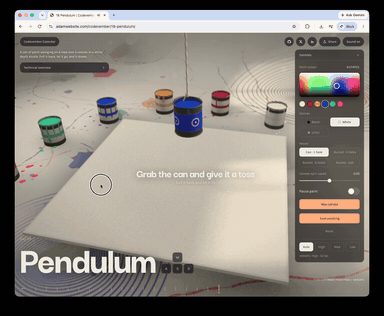

# Day 18: Pendulum

[Try it live](https://adamwebsite.com/codevember/18-pendulum/)

A can of paint swinging on a rope over a canvas in a white daylit studio. Pull it back, let it go, and it draws.

## How to play

Grab the can, pull it back and let it fly: it swings and pours, drawing as it goes. Try a bucket with more holes or a slot, spin it or the canvas either way, and save your painting when you like it.

Run it locally with `npm run dev` from the repo root, then open <http://localhost:3000/18-pendulum/>.

## Technical overview

### The swing

- The can is a spherical pendulum stepped 240 times a second, its slowly turning, decaying ellipse drawing the spirograph.
- Grab and throw the can up to 55 degrees out; a dotted line previews the next six seconds by running the pendulum ahead.
- A bucket's 3 or 5 holes or its slot can spin either way about the rope, and the canvas can turn; paint stops before it heaps.

### The paint

- Paint leaves the hole by Torricelli's law as free-falling parcels, drawn as a tube that thins and breaks into beads.
- A GPU thin film on up to 640 by 640 columns flows past its yield stress and dries in seconds, so later lines lie crisply over earlier ones.
- Paint that misses the canvas lands on a second, coarser film over five metres of concrete floor.

### Rendering

- The canvas mesh is displaced straight from the sim, glossy while wet and satin when dry.
- A white loft with a cyclorama and softboxes; walls are built round real window openings, so the sun draws the bars on the floor.
- Save painting draws the canvas from overhead at 2048 pixels, its pipelines prebuilt and pixels converted between frames, so nothing stalls.

Everyone whose work Codevember builds on is listed in [CREDITS.md](../CREDITS.md).
