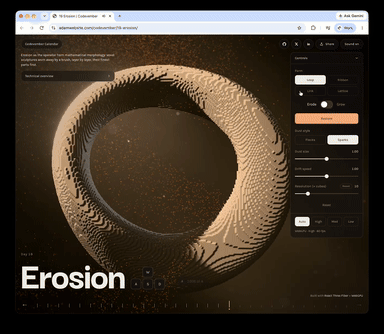

# Day 19: Erosion

[Try it live](https://adamwebsite.com/codevember/19-erosion/)

Erosion as the operator from mathematical morphology: voxel sculptures worn away by a brush, layer by layer, their finest parts first.

## How to play

Drag across the sculpture to erode it, cell by cell: the thinnest parts go first. Switch to Grow (or hold Shift) to build it back up anywhere, as far as you like; Reset brings back the original.

Run it locally with `npm run dev` from the repo root, then open <http://localhost:3000/19-erosion/>.

## Technical overview

### Morphology

- A bit-packed GPU grid, 32 cells a word: erode clears a cell if any neighbour under the round brush is empty; grow fills one if any is full.
- Thin parts go first and never come back as they were: growing rounds everything, which is why erosion then dilation (an opening) loses detail.

### Forms

- Four sculptures that run thin to thick: a twisting loop, a three-half-turn ribbon, two linked rings, a graded lattice.
- Every form is filled once per resolution, one bit a cell, so switching or restoring only copies bits into the grid.

### Dust and detail

- Lost cells cool from embers to tumbling flecks, stepped on the GPU each frame; the pointer pushes and swirls them like a hand through smoke.
- Resolution sets the cube count, 1× to 50× (128³ to 472³ cells); only open faces are drawn, and a new grid fills behind a fade.

Everyone whose work Codevember builds on is listed in [CREDITS.md](../CREDITS.md).
