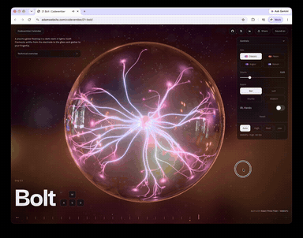

# Day 21: Bolt

[Try it live](https://adamwebsite.com/codevember/21-bolt/)

A plasma globe floating in a dark room it lights itself: filaments writhe from the electrode to the glass and gather to your fingertip.

## How to play

Touch the glass and the lightning swings to your fingertip; drag to lead it, or use several fingers on a phone. Drag anywhere off the globe to spin all the way round it; on a computer, right-drag (or Shift-drag) pans. Turn on IRL Hands to touch it with your real fingers through the camera: the tracking runs on this device and nothing is uploaded. Pinch to turn the view, or pinch with both hands to zoom.

The day also has six earlier versions (Lichtenberg, Wingnut, Storm, Ladder, Fulgurite, Silk), opened with `?v=` in the address, for example <http://localhost:3000/21-bolt/?v=storm>.

The recorded touch buzz and the music on the live site are licensed to it only and are not in this repo; here the buzz is synthesised and there is no music.

Run it locally with `npm run dev` from the repo root, then open <http://localhost:3000/21-bolt/>.

## Technical overview

### Filaments

- Up to 26 filaments, each a rope of three strands twisting round a wandering arc, laid out on the CPU each frame as camera-facing strips.
- White-hot cores clip to white under bloom; each fades into a wide halo of gas, and frays into forked twigs that fizz where it meets the glass.

### Touch

- A touch locks the nearest filament to it; held longer, others crawl over, then wind round it into one bundle as their energy goes to it.
- Every finger is its own contact, up to five; the glass under each warms to a glow that fades slowly after letting go.

### IRL Hands

- MediaPipe's hand landmarker tracks your hands from the camera in a worker, on this device, 30 times a second.
- Each straight fingertip within reach is smoothed with a One Euro filter, then cast through the camera onto the glass.
- A low-poly hand mesh is posed rigidly from the landmarks and glows where it touches; pinch to turn the view, two hands to zoom.

### Glass and air

- Added light only: a thin-shell Fresnel reflection, tip splashes, fingerprints that catch the light, and the gas glow along each view ray.
- The filaments are drawn again into a small target each frame, so the thick rim shows them bent; air scattering is a closed-form 1/r² line integral.

Everyone whose work Codevember builds on is listed in [CREDITS.md](../CREDITS.md).
