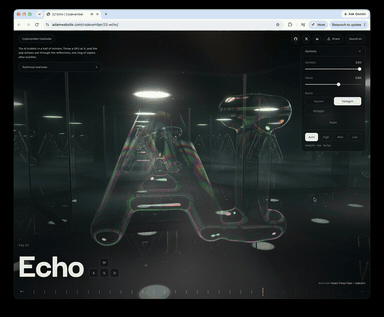

# Day 22: Echo

[Try it live](https://adamwebsite.com/codevember/22-echo/)

The AI bubble in a hall of mirrors. Throw a GPU at it, and the pop echoes out through the reflections, one ring of copies after another.

## How to play

Point at the bubble to hold up a GPU, with a dotted arc showing where it will go; tap to throw it. Hold on the bubble to pump it up until it bursts by itself. Drag to look round the mirrors, all the way round. On a phone, press the bubble to aim and let go to throw. Confetti, in the panel, sets how much bursts out.

The other studies of Echo made on the way open in development with `?v=` in the address: `rain`, `whale`, `ultrasound`, `interference`, `dust`, `isoline`, `ripple`, `cymatic`, `pressure`, `afterimage`, `motes`, `shed`, `murmur`, `bubble`, `nebula`, `pop`, `sonar` and `gum`.

Run it locally with `npm run dev` from the repo root, then open <http://localhost:3000/22-echo/>.

## Technical overview

### Mirrors

- Every pixel traces its ray off the smoked-glass walls and polished floor up to ten times, so each copy is a true reflection
- Each reflection sees the bubble as it was a beat earlier, so the burst runs out through the copies like the sound's echoes

### Bubble

- The letters are a distance field of melted round strokes, marched exactly in every reflection, rippled by a gusting breeze
- Its colours are real thin-film interference over a drained, swirling film; the tear thins it to black ahead of the rim
- Rays far from the film step by a cheap baked distance less a safe bound, and work the full rippled one only close in

### The toss and the burst

- Over the bubble a graphics card is held up, with a dotted arc to the point under the pointer; a tap lobs it along that arc
- The burst is procedural confetti: two-fan cards and sticks of memory built from boxes and extrusions, one draw each, weightless on a drifting current
- Only live pieces are drawn, and the droplet spray is tested only where a ray passes each reflection's bounding sphere

### Air

- A low mist on the floor, summed exactly along each ray leg, so every reflection carries it off into the haze
- Smoke stirs in the softbox's light column, and dust drifts on the same breeze as the film

Everyone whose work Codevember builds on is listed in [CREDITS.md](../CREDITS.md).
